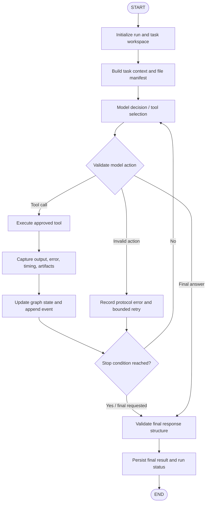

# Research-Grade Data Analysis Agent
## Product Requirements, Technical Specification, and Build Plan

**Project:** `trustworthy-agentic-ai`  
**Document version:** 1.0  
**Status:** Proposed build specification — approve and refine before implementation  
**Primary framework:** LangGraph (Python)  
**Primary purpose:** Produce a capable, reproducible data-analysis agent and a trustworthy execution harness for research on intermediate failures, uncertainty, and recovery.

---

# 0. Executive decision

Build a **single-agent, tool-using data-analysis system** with a controlled LangGraph execution loop. It should have the core capabilities expected from modern data-analysis agents: inspect files, understand schemas, execute Python/SQL, iterate on results, create tables/charts/artifacts, and deliver a grounded answer.

It is not the goal to clone a proprietary product internally or implement every enterprise feature. The goal is to match the relevant user-facing capabilities while making execution observable, reproducible, model-switchable, and suitable for controlled research.

The first release is a strong CLI-based research harness. A polished web UI, collaborative workspaces, multi-agent delegation, warehouse connectors, scheduled jobs, and dashboard publishing are later extensions—not prerequisites for the first research pilot.

**Core design rule:** The agent performs the task. A separate evaluation system later judges the recorded execution. The agent must not receive hidden reference answers, task contracts, or evaluation labels.

# 1. Product vision and scope

## 1.1 Product vision

A user provides a data-analysis task and a controlled workspace containing datasets and supporting documents. The agent should:

1. Understand the requested outcome and constraints.
2. Discover available files and inspect relevant data.
3. Select suitable operations and tools.
4. Write and execute analysis code.
5. Inspect execution results and continue when more work is needed.
6. Validate its own outputs using available non-oracle checks (for example, schema checks, row counts, arithmetic consistency, and execution status).
7. Produce a final answer supported by observable outputs and saved artifacts.
8. Preserve a complete execution record that can be replayed and analyzed later.

The agent should behave like a capable junior data analyst who can use tools—not like a chatbot that guesses answers from the prompt.

## 1.2 Product principles

- **Correctness over theatrics:** Do not add unnecessary agents, planning loops, or reflection calls merely to look sophisticated.
- **Observable execution:** Every model request, tool request, tool result, state transition, error, and final response must be recorded.
- **No hidden evaluation leakage:** Reference answers and benchmark oracles stay outside the agent's runtime workspace.
- **One stable interface:** Switching between API and open-weight models changes configuration, not graph logic or tool semantics.
- **Reproducibility:** Every run records enough provenance to explain what was executed and to replay tool execution.
- **Explicit failure:** Errors, retries, truncation, timeouts, and unsupported capabilities must be visible in logs.
- **Security by boundary:** Generated code runs in an isolated execution environment; it must not inherit API secrets or have unrestricted host access.
- **Incremental complexity:** First make one agent and a small tool set reliable. Add optional capabilities only when pilot tasks require them.

## 1.3 In-scope for v1

- DABStep-style data-analysis tasks.
- Local, task-scoped data workspaces.
- Common structured data formats used by the benchmark.
- Supporting text/document sources where required by tasks.
- Python analysis and optional SQL analysis.
- Iterative tool use through a LangGraph loop.
- API/open-weight backend configuration.
- Structured logging, run manifests, artifacts, checkpointing, and replay.
- CLI to run and inspect experiments.
- Unit, integration, replay, and safety tests.

## 1.4 Explicitly out of scope for v1

- Multi-agent teams or autonomous agent-to-agent delegation.
- General-purpose web browsing or arbitrary internet access.
- Production multi-tenant SaaS, accounts, billing, or collaboration.
- Enterprise warehouse integrations (Snowflake, BigQuery, etc.).
- Scheduled background work.
- Automatic dashboard hosting or publishing.
- A sophisticated graphical UI.
- A research evaluator that decides whether a step is semantically correct.
- Automatic causal claims from observational execution traces.

These can be considered after the core research harness is stable.

# 2. Product capability baseline

Modern data-analysis products commonly combine natural-language interaction with file ingestion, code-backed analysis, tabular outputs, visualizations, iterative refinement, and exportable results. Hex additionally emphasizes SQL/Python notebook workflows, workspace context, and governance/observability. These are useful capability references, not architectures to copy.

For v1, implement the following capability baseline:

| Capability | v1 requirement | Notes |
|---|---|---|
| Natural-language task input | Must | CLI input and benchmark task loader |
| File discovery | Must | List only files in the task workspace |
| Data inspection | Must | Schema, dimensions, dtypes, nulls, bounded sample |
| Document inspection | Must | Search/read supported local task documentation |
| Python execution | Must | Isolated, bounded, repeatable execution |
| SQL analysis | Should | DuckDB is a reasonable local option; only add after task audit confirms value |
| Iterative analysis | Must | Agent observes tool results and decides next action |
| Tables and summaries | Must | Final output can include structured results |
| Charts | Should | Save chart files as artifacts; do not require a UI |
| Exportable artifacts | Must | CSV/JSON/PNG/Markdown as appropriate |
| Provenance | Must | Link claims to files, code, tool outputs, and event IDs |
| Resume/checkpoint | Should | LangGraph persistence for interrupted runs |
| Model backend switch | Must | API and open-weight via configuration |
| Execution trace | Must | Append-only machine-readable event log |
| Replay | Must | Replay recorded tool actions without regenerating model text |
| Human approval | Later | Add for high-impact/destructive operations if the product scope expands |

**Market reference sources:**
- OpenAI Help Center, “Data analysis with ChatGPT”: https://help.openai.com/en/articles/8437071-data-analysis-with-chatgpt
- OpenAI Help Center, “Extracting Insights with ChatGPT Data Analysis”: https://help.openai.com/en/articles/9213685-extracting-insights-with-chatgpt-data-analysis
- Hex documentation, “AI Features”: https://learn.hex.tech/docs/getting-started/ai-overview
- Hex documentation, “Chat with App”: https://learn.hex.tech/docs/explore-data/chat-with-app

# 3. User and execution workflow

## 3.1 User workflow

1. User selects a task ID or supplies a task prompt.
2. Agent creates a unique run and task workspace.
3. Agent inventories available files.
4. Agent inspects relevant files and schemas.
5. Agent carries out a tool-using analysis loop.
6. Agent receives tool observations and decides whether to continue, retry, or finish.
7. Agent returns a structured final answer with concise explanation and artifact references.
8. System saves the full trace, run manifest, final result, and artifacts.

## 3.2 Agent loop

The agent may perform many turns. A turn is one model response/action cycle, not a claim that it contains exactly one research step. One turn may call one or more tools or contain multiple operations inside a code block. Later evaluation may inspect operations inside a turn.

Proposed graph:



The graph should combine deterministic nodes (validation, routing, execution, logging, budget checks) with an LLM-driven decision node. LangGraph is suitable for this kind of explicit stateful workflow. Use a custom `StateGraph`; do not build the research design around a deprecated convenience API.

# 4. Functional requirements

## FR-01 — Task and workspace initialization

- Every run receives a unique `run_id`.
- Every task receives a stable `task_id`.
- Every run gets a separate working directory.
- Input datasets are mounted or copied read-only where practical.
- Agent-generated code and artifacts are written only to the run workspace.
- The task workspace must not expose other tasks' data or previous runs' scratch files.

**Acceptance tests:** two simultaneous or sequential runs do not share mutable state or artifacts; the agent cannot traverse outside its allowed workspace through file tools.

## FR-02 — File discovery and inspection

Provide tools with narrow, typed interfaces:

- `list_files`: list allowed files and basic metadata.
- `inspect_file`: identify format, sheet names where applicable, row/column counts, schema, data types, null counts, and size.
- `read_file_sample`: return a bounded sample or selected columns/rows.
- `search_text_sources`: find relevant text in supported local documentation files.

Support only formats present in the task corpus at first. Likely formats include CSV/TSV, JSON, XLSX, TXT/Markdown, and PDF if task documentation requires it. Do not implement a broad document-ingestion framework before auditing actual task formats.

**Acceptance tests:** malformed files return structured errors; large files are not fully dumped into model context; path traversal is rejected; tool outputs include source file identity.

## FR-03 — Python execution

- Agent can submit Python code to a dedicated execution tool.
- Execution is scoped to one run workspace.
- Input data is read-only; outputs go to an allowed output directory.
- Each execution returns stdout, stderr, exit status, duration, and produced artifact metadata.
- Execution has configurable time, memory, output-size, and iteration limits.
- A failed execution is logged as a failed event; it must not be silently rewritten as success.
- If the agent repairs code, the repair is a new model/tool event.

Do not claim that a plain subprocess is a secure sandbox. For the actual model-run pilot, use container/VM isolation or another enforced sandbox with an unprivileged user, resource limits, restricted filesystem, and no network by default. A local subprocess backend may be retained for trusted development tests, clearly marked as non-sandboxed.

**Acceptance tests:** timeout, non-zero exit, syntax error, excessive output, disallowed path, and attempted network access are handled and recorded as expected.

## FR-04 — SQL execution (optional for first slice)

If task audit shows SQL adds value, expose a bounded DuckDB tool over the task workspace. It must use read-only access to input data, log the exact SQL, record query duration and structured results, and apply row/output limits.

Do not give the model unrestricted database credentials or a remote production database connection.

## FR-05 — Iterative tool use

- The model can request tools through a common action/tool-call protocol.
- Tool names and arguments are validated against registered schemas.
- Unknown tools and malformed arguments are rejected and logged.
- The result is returned to the agent as a bounded observation.
- The agent may continue, call another tool, or return a final answer.
- Max turns, tool calls, consecutive failures, tokens, and wall-clock time are configurable.
- No infinite loops.

## FR-06 — Final response

The final response should contain a typed structure:

```json
{
  "status": "success | partial | failed",
  "answer": "string or structured value",
  "summary": "concise explanation of the result",
  "assumptions": [],
  "limitations": [],
  "artifacts": [],
  "evidence": [
    {
      "claim": "short claim",
      "source_file": "relative path",
      "event_ids": ["event-id"]
    }
  ]
}
```

The schema can be adjusted for benchmark answer formats. The agent must not invent file references or evidence. If the answer cannot be established, it should state uncertainty or failure rather than fabricate a value.

Do not ask the model to reveal hidden chain-of-thought. Log observable decisions, concise action rationales if emitted, tool inputs/outputs, and state transitions—not private internal reasoning.

## FR-07 — Artifact creation

The agent should be able to save appropriate artifacts:

- CSV/JSON data outputs.
- PNG charts.
- Markdown or JSON summary report.
- Any task-specific output file required by the benchmark.

Every artifact has a relative path, MIME/type, byte size, checksum, and producing event ID.

## FR-08 — Model backend switching

A run selects one backend at initialization. Do not switch models midway through a run in v1.

Configuration concept:

```yaml
model:
  backend: api  # api | open_weight
  provider: "provider_name"
  model_id: "exact_model_identifier"
  base_url: null
  api_key_env: "MODEL_API_KEY"
  temperature: 0.0
  top_p: 1.0
  max_output_tokens: 4096
  seed: null
  request_timeout_seconds: 120
```

A separate profile can configure an open-weight model:

```yaml
model:
  backend: open_weight
  runtime: "openai_compatible | transformers | other_supported_runtime"
  model_id: "exact_checkpoint_or_served_model_id"
  base_url: "configured_local_or_server_endpoint"
  temperature: 0.0
  top_p: 1.0
  max_output_tokens: 4096
  seed: null
```

Use a common internal model interface and provider-specific adapters. Record provider, exact model ID/revision, endpoint/runtime, generation settings, capability flags, token usage, request IDs when available, and whether log probabilities were available.

Model capability is not identical across providers. Some backends may not support log probabilities, native tool calls, structured output, or deterministic seeds. The agent should expose these differences as capabilities, not silently pretend equivalence.

The API provider and the open-weight runtime are intentionally not hard-coded in this spec. Choose them after checking cost, tool-calling support, log-probability access, available hardware, and the intended comparison.

## FR-09 — Run persistence and checkpointing

- Use LangGraph checkpointing for run/thread state where needed.
- Use SQLite for local development/pilot unless concurrency requirements justify another backend.
- `thread_id` identifies a resumable graph thread; `run_id` identifies one experimental execution.
- Checkpoint storage and raw event logs are separate systems. A checkpoint is not a substitute for an audit log.
- Resume behavior must be explicit and tested; do not accidentally resume one experimental repetition as another.

## FR-10 — Logging and replay

Use append-only JSONL event logs plus a run manifest and final result file.

Every event has a common envelope:

```json
{
  "schema_version": "1.0",
  "event_id": "uuid",
  "run_id": "uuid",
  "task_id": "task-1871",
  "thread_id": "uuid",
  "sequence": 12,
  "parent_event_id": "uuid-or-null",
  "timestamp_utc": "ISO-8601",
  "event_type": "model_response | tool_call | tool_result | state_update | run_finished",
  "graph_node": "node-name",
  "payload": {}
}
```

Log events at minimum:

- `run_started`, `task_loaded`, `workspace_created`
- `model_request_started`, `model_response_received`, `model_request_failed`
- `tool_call_requested`, `tool_execution_started`, `tool_execution_completed`, `tool_execution_failed`
- `observation_added`, `state_updated`
- `budget_limit_reached`, `invalid_action`, `run_finished`
- `artifact_created`

Capture raw prompts/model outputs where permitted and useful, but redact secrets and credentials. Preserve the exact action/code and tool result. Record truncation explicitly. Do not put API keys, tokens, environment dumps, or secrets in logs.

Run manifest must record:

- `run_id`, task ID, start/end times, status
- Git commit hash and dirty-tree status
- Python version, OS/runtime, dependency lock hash
- dataset/source file relative paths, byte sizes, SHA-256 checksums
- prompt version and config/profile checksum
- model provider, exact ID/revision, runtime, parameters, capability flags
- executor type, isolation profile, resource limits
- random seeds and whether the backend honored them

Replay modes:

1. **Tool replay:** Feed recorded model actions/tool calls back into the execution environment and compare outputs. This tests execution reproducibility without requiring model regeneration.
2. **Model resampling:** Reinvoke the model on a saved prefix to measure output variation. This is not exact replay; provider/model updates and stochasticity can change outputs.

A log-completeness test should select any event, reconstruct the exact tool inputs and required context from the log/manifest, and rerun it. Compare output hashes or explicitly explain nondeterminism.

## FR-11 — Run inspection

CLI commands should support:

```text
agent run --task-id 5 --config configs/api.yaml
agent run --task-id 5 --config configs/open_weight.yaml --repeat 3
agent inspect-run --run-id <id>
agent replay-run --run-id <id> --mode tools
agent validate-logs --run-id <id>
agent list-runs --experiment <name>
```

CLI syntax can be refined, but each action must be easy to script and reproduce.

# 5. Non-functional requirements

| Area | Requirement |
|---|---|
| Reliability | Exceptions are caught at graph/tool boundaries, logged, and returned as typed outcomes |
| Reproducibility | Every run carries data, code, prompt, model, and environment provenance |
| Isolation | One run cannot read/write another run's workspace |
| Security | No inherited API secrets in generated-code processes; no unrestricted host access |
| Observability | Every meaningful externally visible operation has an event record |
| Portability | Windows development supported; experiment execution should use a documented isolated runtime |
| Maintainability | Typed schemas, small modules, configuration-driven behavior |
| Testability | Model calls, tool execution, graph routing, logging, and replay can be tested independently |
| Boundedness | Explicit max turns, time, output, memory, retries, and tool budgets |
| Model portability | Same graph and tools behind a common model adapter |

# 6. Proposed software architecture

## 6.1 Layers

1. **CLI/application layer:** accepts task/config, creates run, prints progress/final result.
2. **Graph orchestration layer:** LangGraph state, nodes, edges, stop conditions, checkpointing.
3. **Model adapter layer:** common interface for API and open-weight backends.
4. **Tool layer:** file inspection, documentation search, Python execution, optional SQL, artifact output.
5. **Execution runtime:** isolated run workspace and code-execution boundary.
6. **Telemetry layer:** append-only events, run manifest, replay, checksums.
7. **Evaluation layer (separate future package):** task contracts, reference quantities, step annotations, uncertainty analysis, statistical analysis. Not imported into the agent runtime.

## 6.2 Suggested graph nodes

- `initialize_run`
- `load_task_context`
- `agent_decide`
- `validate_action`
- `execute_tool`
- `record_observation`
- `check_budgets`
- `finalize_response`
- `close_run`

Use deterministic routing after `validate_action`. Only the decision node needs model generation.

## 6.3 Suggested state fields

Use a typed state schema (for example, TypedDict with validated payload models). Keep large logs outside graph state.

- `run_id`, `task_id`, `thread_id`
- `task_prompt`, `task_metadata`
- `workspace_root`, `input_manifest`, `allowed_paths`
- `messages` or compact conversation state
- `turn_index`, `tool_call_count`
- `current_action`, `last_observation`
- `recent_event_ids`
- `run_status`, `finish_reason`
- `token_usage`, `budget_state`
- `final_response`, `artifact_manifest`

Do not store the entire append-only event history in the graph state. Append events through a dedicated event sink.

## 6.4 Suggested repository layout

Adapt to the existing repository instead of blindly replacing it. A possible target is:

```text
trustworthy-agentic-ai/
├── README.md
├── pyproject.toml
├── .env.example
├── .gitignore
├── configs/
│   ├── api.yaml
│   ├── open_weight.yaml
│   └── agent.yaml
├── src/
│   └── trustworthy_agent/
│       ├── __init__.py
│       ├── cli.py
│       ├── config/
│       │   └── settings.py
│       ├── graph/
│       │   ├── state.py
│       │   ├── workflow.py
│       │   ├── nodes.py
│       │   └── routing.py
│       ├── models/
│       │   ├── base.py
│       │   ├── factory.py
│       │   └── adapters/
│       ├── tools/
│       │   ├── registry.py
│       │   ├── files.py
│       │   ├── inspect_data.py
│       │   ├── search_docs.py
│       │   ├── python_exec.py
│       │   ├── sql.py
│       │   └── artifacts.py
│       ├── runtime/
│       │   ├── workspace.py
│       │   └── sandbox.py
│       ├── telemetry/
│       │   ├── events.py
│       │   ├── event_logger.py
│       │   ├── manifest.py
│       │   └── replay.py
│       ├── schemas/
│       │   ├── actions.py
│       │   └── outputs.py
│       └── prompts/
│           ├── system.md
│           └── tool_policy.md
├── tasks/
├── runs/                 # git-ignored
├── tests/
│   ├── unit/
│   ├── integration/
│   ├── replay/
│   └── fixtures/
├── scripts/
└── research/
    ├── protocol/
    ├── feasibility/
    ├── literature/
    └── experiments/
```

This is a target shape, not an instruction to move every file immediately. Keep existing `answers.py`, `parser.py`, `executor.py`, `logger.py`, and `llm.py` if their behavior is sound; adapt them behind the new interfaces. The old `loop.py` is the main orchestration component that the graph replaces. The repository inventory shows these modules are relatively independent, so a controlled migration is preferable to a destructive rewrite.

# 7. Model abstraction and fairness

## 7.1 Common model interface

Define a small interface with operations such as:

- `invoke(messages, tools, generation_config) -> ModelResponse`
- `stream(...)` if supported
- `capabilities() -> ModelCapabilities`
- `metadata() -> ModelMetadata`

`ModelResponse` should normalize:

- message content
- native tool calls (if any)
- finish reason
- usage/token counts
- provider request ID
- available log probabilities
- raw provider metadata (allowlisted, secret-free)

## 7.2 Backend switch

Use configuration, not code edits. Select exactly one backend per run. For paired model comparisons, keep the following fixed where possible:

- agent system prompt and tool descriptions
- graph structure and stop rules
- datasets and workspace
- tool implementations and versions
- execution environment and resource limits
- number of attempts and evaluation rules

Record model-specific differences such as context limits, native tool-call support, log-probability availability, quantization, and inference runtime. Do not claim two models were evaluated under identical conditions when they were not.

## 7.3 Prompt policy

The prompt should instruct the agent to:

- inspect relevant files before assuming schema or contents
- use tools for computation rather than inventing numbers
- keep operations bounded and task-relevant
- inspect tool outputs before continuing
- state assumptions and limitations
- report when evidence is insufficient
- avoid destructive operations
- provide concise action rationales, not hidden chain-of-thought
- finish only when the requested output is available or a bounded failure condition is reached

Do not ask for or attempt to log private internal reasoning. Research should analyze observable actions, code, tool calls, outputs, and confidence signals.

# 8. Execution security and data isolation

Generated code is untrusted input. A subprocess alone is not a security sandbox.

Minimum requirements for experiment runs:

- unprivileged execution identity
- isolated per-run container/VM or equivalent enforced sandbox
- task inputs mounted read-only
- run output directory mounted writable
- no host home directory or repository secrets mounted
- no API credentials passed to the Python execution process
- network disabled by default
- CPU, memory, process-count, wall-clock, and output-size limits
- bounded filesystem access
- pinned base image/runtime and package versions
- cleanup policy for temporary execution state

Development may use a local executor for trusted synthetic tests, but experimental runs involving model-generated code should use the enforced sandbox. The event manifest must record which executor was used.

# 9. Research separation: agent versus evaluator

This boundary is critical.

## Agent responsibilities

- solve the task
- inspect files
- generate actions/code
- call tools
- observe outputs
- create artifacts
- produce a final response
- record the observable execution

## Future evaluator responsibilities

- load task contracts/reference quantities
- map observable operations and outputs to evaluation units
- assess information correctness, operation validity, execution correctness, and conclusion validity
- assess task alignment, dependencies, recovery, and downstream effects
- join uncertainty signals to the appropriate generation/turn
- calculate metrics and confidence intervals
- sample runs for human annotation
- run controlled counterfactual interventions

The evaluator's reference data must be stored separately from the agent's task workspace and must never be exposed through the agent's tools or prompt. This prevents benchmark answer leakage.

The agent must record enough raw evidence to support future evaluator changes, but must not itself decide that a semantic intermediate result is correct merely because it looks plausible.

# 10. Logging schema and completeness standard

## 10.1 Event types

At minimum, define typed payloads for:

- run lifecycle
- task/workspace manifest
- model request and response
- tool request and result
- execution output/error
- artifact creation
- state transition
- final response
- budget/stop event

## 10.2 Completeness test

For any selected tool event, a test script should be able to:

1. Identify the exact code/tool arguments.
2. Identify the input files and checksums used.
3. Reconstruct the relevant runtime configuration.
4. Re-execute in an equivalent environment.
5. Compare structured outputs or hashes.
6. Report nondeterministic differences rather than hiding them.

The log-completeness test is an engineering acceptance criterion. It does not prove that the model's next generation can be reproduced exactly.

# 11. Testing strategy

## 11.1 Unit tests

- configuration validation and backend factory
- model response normalization
- action schema validation
- tool registry and argument validation
- file path and workspace restrictions
- each file inspection tool
- Python executor success/error/timeout/output-limit paths
- event schema and append-only behavior
- manifest hashes and provenance
- final response schema

## 11.2 Graph integration tests

- simple task: inspect -> execute -> final
- multi-turn task: inspect -> code -> observe -> revise -> final
- invalid tool name
- malformed arguments
- tool exception
- repeated tool failure and stop condition
- max turns/token/time reached
- final answer without tool use
- checkpoint/resume
- separate runs do not share state

## 11.3 Replay tests

- replay recorded tool calls
- compare stdout/stderr/exit code and artifact hashes
- detect missing input files or changed checksums
- ensure replay does not call the LLM

## 11.4 Model adapter tests

Use a fake model for deterministic tests. Add one API smoke test and one open-weight smoke test separately. Network-dependent tests should be opt-in and not make the core test suite flaky.

## 11.5 Safety tests

- path traversal attempts
- attempts to read outside workspace
- attempts to access environment secrets
- attempted network requests
- long-running loops/timeouts
- excessive output
- writes to read-only inputs

# 12. Build plan and milestones

Build in small vertical slices. Do not ask Claude Code to generate the entire system in one pass.

## Phase 0 — Preserve baseline and inspect current repository

**Tasks**
- confirm clean Git state and `baseline-v0` tag
- inspect current source and tests
- read the current README and research notes
- record what can be reused
- create a feature branch for the rebuild (recommended)

**Exit criteria**
- baseline tag remains available
- architecture plan is reviewed
- no existing feasibility evidence is deleted

## Phase 1 — Project foundation and typed schemas

**Tasks**
- add project packaging/dependency lock
- define config models
- define action, tool result, final output, event, and run manifest schemas
- implement unique run workspace creation
- implement basic CLI shell

**Exit criteria**
- config validation works
- schemas have unit tests
- a fake run can initialize and close cleanly

## Phase 2 — Model adapter and backend switch

**Tasks**
- define common model interface
- preserve/adapt fake model for deterministic tests
- implement one chosen API adapter
- implement one open-weight adapter/runtime
- add capability metadata and config switch

**Exit criteria**
- same smoke task can use either backend without changing graph/tool code
- model request metadata is recorded
- unavailable capabilities are explicitly represented

## Phase 3 — Data workspace and tools

**Tasks**
- implement list/inspect/sample tools
- implement documentation search for required local formats
- implement Python execution behind a sandbox interface
- add DuckDB only if justified by task requirements
- implement artifact registry

**Exit criteria**
- every tool has typed input/output and tests
- workspace boundaries are enforced
- execution limits and failure paths are verified

## Phase 4 — LangGraph orchestration

**Tasks**
- define typed graph state
- implement the graph nodes and conditional routing
- add tool execution and observation loop
- add budget/stop conditions
- add checkpointing

**Exit criteria**
- fake model completes deterministic one-tool and multi-tool tasks
- invalid actions and tool errors are handled
- graph state is isolated per run

## Phase 5 — Telemetry, artifacts, and replay

**Tasks**
- implement append-only JSONL event logger
- implement run manifest and checksums
- capture model/tool/environment metadata
- implement artifact metadata
- implement tool replay
- implement log completeness validator

**Exit criteria**
- a complete run can be reconstructed from its stored inputs/logs
- replay tests pass for deterministic tool calls
- logs contain no secrets

## Phase 6 — End-to-end agent validation

**Tasks**
- run one easy task and one hard task for plumbing only
- inspect every event and output
- fix missing metadata, workspace contamination, and execution bugs
- run selected repeated tasks for exploratory behavior

**Exit criteria**
- no unexplained missing events
- no cross-run state leakage
- reliable tool execution and usable final answers
- complete run manifest and replay record

## Phase 7 — Research pilot readiness

**Tasks**
- inspect trajectory variety across a small task set
- test draft step/operation segmentation rules against real traces
- identify any additional raw signals needed
- finalize a frozen log schema and protocol version
- define exploratory versus held-out confirmatory tasks

**Exit criteria**
- Protocol v1.0 is versioned
- the main experiment cannot use exploratory tasks as confirmatory evidence
- reference/oracle material remains outside agent runtime

# 13. Definition of done for Agent v1

Agent v1 is ready for the research pilot only when all are true:

- [ ] One API backend works through the common interface.
- [ ] One open-weight backend works through the same interface.
- [ ] Same graph and tools are used across backends.
- [ ] Agent can inspect relevant task files and data schemas.
- [ ] Agent can execute Python in the controlled environment.
- [ ] Agent can iterate on observations and produce final output.
- [ ] Artifacts are stored and referenced.
- [ ] Each run has its own workspace and ID.
- [ ] Append-only event log captures all required events.
- [ ] Run manifest captures code, data, prompt, model, and environment provenance.
- [ ] Tool replay works without calling the LLM.
- [ ] Log completeness test passes on representative events.
- [ ] Budget, timeout, and failure handling tests pass.
- [ ] Security boundary is documented and tested.
- [ ] Ground-truth answers and research contracts are not exposed to the agent.
- [ ] Unit and integration tests pass.

# 14. Decisions to make before implementation

These are the few decisions that genuinely need the user's input. Do not silently invent them:

1. **First API provider/model:** choose based on tool calling, cost, log-probability availability, context size, and research budget.
2. **Open-weight runtime:** choose a local/server runtime compatible with available hardware and tool calling. Keep the adapter abstract.
3. **Execution isolation:** decide whether Docker is available on the Windows development machine or whether experiments will run in a Linux container/VM/server.
4. **SQL tool:** include DuckDB in the first version only if DABStep tasks or the pilot justify it; Python remains mandatory.
5. **Input formats:** confirm actual formats in the benchmark task workspace before implementing more parsers.

Everything else should use the defaults and acceptance criteria in this document unless a pilot reveals a concrete issue.

# 15. Claude Code working agreement

Claude Code must work incrementally and preserve the repository.

- Read this specification and inspect the actual repository before editing.
- Begin with a plan and file-by-file migration map; do not immediately write code.
- Do not overwrite the old agent or feasibility scripts without understanding their role.
- Preserve `baseline-v0`, old feasibility evidence, and the golden fake run.
- Prefer adapting reusable modules over rewriting them.
- Do not add dependencies without explaining why.
- Do not implement multi-agent orchestration or a GUI in v1.
- Do not expose ground-truth values to the agent.
- Do not call a local subprocess a secure sandbox.
- Write tests with each feature; run the full test suite after each milestone.
- Work one vertical slice at a time and summarize changed files, tests, and remaining risks.
- Do not make Git commits or push without the user's instruction.
- If a decision is not specified, report it as an explicit blocker or use a clearly labelled temporary default; do not silently choose a research-affecting setting.

---

# References consulted for architecture and capability baseline

1. LangChain team, “LangChain and LangGraph Agent Frameworks Reach v1.0 Milestones,” 22 October 2025. https://www.langchain.com/blog/langchain-langgraph-1dot0
2. LangGraph Python documentation, overview. https://langchain-ai.github.io/langgraph/
3. LangGraph Python package reference. https://reference.langchain.com/python/langgraph/overview
4. LangGraph PyPI project and release history. https://pypi.org/project/langgraph/
5. OpenAI Help Center, “Data analysis with ChatGPT.” https://help.openai.com/en/articles/8437071-data-analysis-with-chatgpt
6. OpenAI Help Center, “Extracting Insights with ChatGPT Data Analysis.” https://help.openai.com/en/articles/9213685-extracting-insights-with-chatgpt-data-analysis
7. Hex documentation, “AI Features.” https://learn.hex.tech/docs/getting-started/ai-overview
8. Hex documentation, “Chat with App.” https://learn.hex.tech/docs/explore-data/chat-with-app

The framework docs and product pages are capability references. This specification is a project design proposal, not a claim that any commercial product uses the same internal architecture.
